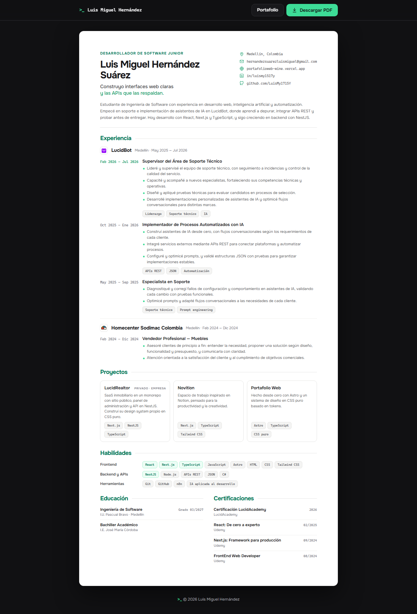

# `>_` CV · Luis Miguel Hernández Suárez

**Desarrollador de Software Junior** — Construyo interfaces web claras y las APIs que las respaldan.

Hoja de vida web, lista para imprimir en A4, con el mismo sistema visual de mi [portafolio](https://portafolioweb-wine.vercel.app/).

[**Ver CV en línea**](https://cv-one-gilt.vercel.app/) · [Portafolio](https://portafolioweb-wine.vercel.app/) · [LinkedIn](https://www.linkedin.com/in/luismy1517y/) · [GitHub](https://github.com/LuisMy1715Y)



---

## Características

- **Exportación a PDF** desde el botón *Descargar PDF*: usa la impresión del navegador con estilos dedicados para A4, sin barra superior, sombras ni cortes dentro de cada cargo.
- **Diseño responsive** para escritorio, tablet y celular, sin desbordes horizontales.
- **Identidad del portafolio**: acento verde menta, tipografía Onest con detalles monoespaciados y tokens de diseño compartidos (color, radios, tipografía).
- **HTML semántico y accesible**: secciones con encabezados, listas reales para habilidades y etiquetas, `aria-label` en las acciones y foco visible.
- **Sin dependencias ni build**: HTML, CSS y un poco de JavaScript.

## Contenido

| Sección | Qué incluye |
| --- | --- |
| Experiencia | LucidBot (soporte, implementación de IA y supervisión) y Homecenter Sodimac |
| Proyectos | LucidRealtor, Novition y Portafolio Web |
| Habilidades | Frontend, Backend y APIs, Herramientas |
| Educación | Ingeniería de Software — I.U. Pascual Bravo |
| Certificaciones | LucidAcademy, React, Next.js y Desarrollo Frontend |

## Tecnologías


## Estructura

```text
.
├── index.html      # Contenido del CV
├── styles.css      # Tokens, layout, responsive e impresión
├── script.js       # Año del footer y descarga en PDF
├── images/         # Logos de empresas
└── docs/
    └── preview.png # Captura usada en este README
```

## Uso local

No necesita instalación. Abre `index.html` en el navegador o sírvelo con cualquier servidor estático:

```bash
python -m http.server 5510
```

Luego entra a <http://localhost:5510> y usa **Descargar PDF**. En el diálogo de impresión elige *Guardar como PDF*, tamaño A4 y desactiva *Encabezados y pies de página*.

## Contacto

- **Email:** [hernandezsuarezluismiguel@gmail.com](mailto:hernandezsuarezluismiguel@gmail.com)
- **Portafolio:** [portafolioweb-wine.vercel.app](https://portafolioweb-wine.vercel.app/)
- **LinkedIn:** [in/luismy1517y](https://www.linkedin.com/in/luismy1517y/)
- **GitHub:** [LuisMy1715Y](https://github.com/LuisMy1715Y)

---

<sub>`>_` Busco mi próximo rol como desarrollador junior. Si te interesa mi perfil, escríbeme.</sub>
